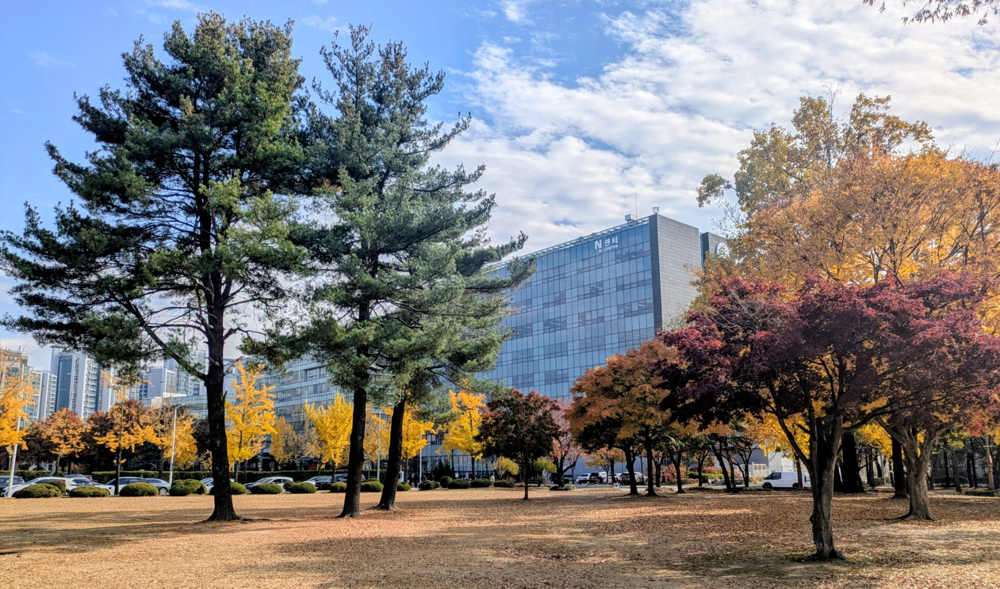

### Contact Information

* **Email:** [wf.podlaski@skku.edu](mailto:wf.podlaski@skku.edu)
* **Office:** Room 86507 (5th Floor), N-Center, Sungkyunkwan University (Natural Sciences Campus)
* **Bluesky:** [@billpod.bsky.social](https://bsky.app/profile/billpod.bsky.social)

---

### Address & Visiting the Lab

#### Address

N Center (Bldg A)
Center for Neuroscience Imaging Research (CNIR)
Sungkyunkwan University (Natural Sciences Campus)
2066 Seobu-ro, Jangan-gu, Suwon-si, Gyeonggi-do, 16419, Republic of Korea

[16419] 경기도 수원시 장안구 서부로 2066 성균관대학교 자연과학캠퍼스 뇌과학이미징연구단 N센터 A동 5층 로비 안내데스크

---

#### Getting Here

* **By Subway:** Take Seoul Subway **Line 1 (Gyeongbu Line)** to **Sungkyunkwan University Station (성균관대역)**, Exit 2. The N-Center is a 10–15 minute walk across campus, or a 3-minute taxi ride from the station exit.
* **By Car / Taxi:** Search for **"성균관대학교 자연과학캠퍼스 N센터"** or **"N-Center SKKU"** in KakaoMap, TMAP, or Naver Maps. Visitor parking is available in the lots adjacent to the N-Center.

---

#### The N-Center

  <!-- Building Photo -->
  

    
    <small class="text-muted d-block text-center mt-1">N-Center, Natural Sciences Campus</small>
  

  
  <!-- Embedded Google Map pinned to N-Center -->
  

    <iframe 
      src="https://www.google.com/maps/embed?pb=!1m18!1m12!1m3!1d3174.5520921471714!2d126.9723223765103!3d37.29388334039868!2m3!1f0!2f0!3f0!3m2!1i1024!2i768!4f13.1!3m3!1m2!1s0x357b425ef870a6c3%3A0x6b77e8011c20579e!2sN-Center!5e0!3m2!1sen!2skr!4v1700000000000!5m2!1sen!2skr" 
      width="100%" 
      height="350" 
      style="border: 0; border-radius: 4px;" 
      allowfullscreen="" 
      loading="lazy" 
      referrerpolicy="no-referrer-when-downgrade">
    </iframe>
    <small class="text-muted d-block text-center mt-1"><a href="https://maps.app.goo.gl/9uB1R3fB3t4V1t4H7" target="_blank">Open in Google Maps ↗</a></small>
  

